# Petri

<p align="center"><a href="https://preacherxp.github.io/30-days-of-tools/"></a></p>

<p align="center"><a href="https://buymeacoffee.com/michal.hachula"></a></p>

A command line tool for people who run Claude Code that scores every session from its transcript, names the mistakes that cost the most, and grows each session into an organism you can replay in the browser.

Run `petri` in a project and it reads that project's transcripts from `~/.claude/projects`. Each session is a run. Every tool call grows a node, errors leave red scars, and a context compaction makes the older growth fade. Each run gets a fitness score out of 100, a ledger of what cost it points (errors, files read twice, oversized tool output, verbatim retries, error streaks, compactions), and up to five "mutations for next run": concrete fixes such as which file was re-read three times or which command flooded the context. `petri --report` prints the same thing as text, and the bundled `/petri` skill lets the agent read its own report and act on it. The visual is one self-contained HTML file, and nothing leaves your machine.

<p align="center"></p>

## Requirements

- macOS or Linux. Windows is untested.
- [Bun](https://bun.sh) 1.4.4 or later to run and build it. There are no runtime dependencies.
- Claude Code session transcripts in `~/.claude/projects`, or `bun run demo` to try it on made-up sessions.
- Google Chrome or Chromium only for the browser tests, which are skipped without it.

## Install

```sh
git clone https://github.com/preacherxp/petri.git
cd petri
bun install      # dev tools, then builds the browser renderer into dist/app.js
bun link         # puts a petri command in ~/.bun/bin
```

Check it with `petri --help`, or try it without any history of your own with `bun run demo`. To update, `git pull` and run `bun install` again, which rebuilds the renderer. To uninstall, run `bun unlink` in the checkout and delete it, then remove the skill folder if you installed it.

To install the `/petri` skill for Claude Code, copy the one in this repo:

```sh
mkdir -p ~/.claude/skills/petri
cp skill/SKILL.md ~/.claude/skills/petri/
```

The skill runs `petri --report` in the project the agent is working in, reads the mutations, applies them in that session and tells you the fitness score and the biggest fix in one line.

## Usage

```sh
petri                        # this project's runs: prints the report, writes dish.html and opens it
petri --report               # text only, for you or an agent
petri --all                  # every project under ~/.claude/projects as one lineage
petri ~/code/my-app          # a working directory; walks up to the nearest parent with sessions
petri path/to/session.jsonl  # one transcript
petri --json                 # all scores and events as JSON
petri --runs 10              # embed full events for the 10 most recent runs (default 40)
petri -o /tmp/dish.html --no-open
bun run demo                 # the same, on ten synthetic sessions
```

Without `bun link`, run `bun src/cli.ts` from the checkout with the same arguments. Note that `bun run petri` always runs inside the checkout, so it needs a path to the project you mean.

The report starts with the latest run:

```text
PETRI · -demo-shop-api · 10 runs · median fitness 66 · best 100
run 10/10  demo0009  2026-11-04 08:33  claude-demo  10m
  Clean up the README and the API examples
  FITNESS 100  ★ NEW BEST
  prompts 3 · turns 29 · calls 38 (1.31/turn) · errors 0 · agents 0 · compactions 0
  tokens out 36k (thinking 42%) · cache hit 97% · peak context 112k
  damage 0.0/100 actions: none
  traits: Clean Run · Forager
lineage: last 5 fitness 87 77 60 85 100, +42 vs previous 5 · traits Forager×6, Surgeon×5, Clean Run×2, Scarred×1, Molted×1
```

Exit codes are `0` on success, `1` when there are no transcripts to score, with the reason on stderr, and `2` for bad arguments.

- **Fitness.** Damage per 100 actions, subtracted from 100. Runs under 20 tool calls count as 20, so one slip can't sink a short run.

  | Damage | Points | When |
  | --- | --- | --- |
  | error | 3 | a tool result marked `is_error` |
  | reread | 2 | a `Read` of the same file and range, with no edit since |
  | fat | 1 per 10k chars over, up to 8 | a tool result over 10,000 characters |
  | retry | 2 | the exact call that failed, repeated in the next turn |
  | thrash | 5 | the third error in a row |
  | molt | 5 | a context compaction |

- **Mutations for next run.** Up to five fixes, biggest damage first. The error one names the first failing call and its message, and adds advice for known messages such as an `Edit` on a file that hasn't been read. Fewer than 1.2 calls per turn over 20 calls or more adds a hint to batch independent reads.
- **Traits.** Clean Run (10+ calls, no errors), Batcher (10+ calls, 1.5+ per turn), Surgeon (8+ edits, under 5% failed), Eidetic (10+ reads, no rereads), Delegator (2+ subagents), Forager (any web fetch or search), Deep Thinker (10k+ output tokens, 60%+ of them thinking), Marathon (200+ calls), and the bad ones: Glutton (5+ oversized results), Scarred (10+ calls, 15%+ failed) and Molted (compacted).
- **Lineage.** All runs in scope, oldest first. The best score only counts runs of 20 calls or more, and the trend compares the median of the last five runs with the five before.
- **What counts as a prompt.** Your messages. Blocks a harness wraps in tags at the start of a message (`<system-reminder>…</system-reminder>`, `<shell id="…">…</shell>`, slash command and `!` shell mode output, background task notices) are removed, and a message with nothing else in it is not a prompt. Interruptions and compaction summaries are left out too.
- **MCP tools.** Harnesses that expose their tools as `mcp__<server>__<tool>` get the same colours and checks as Claude Code's own tools. Petri drops the `mcp__<server>__` prefix and looks the rest up, ignoring case, `_` and `-`:

  | Acts as | Tool names |
  | --- | --- |
  | `Read` | `read`, `read_file`, `read_text_file`, `read_multiple_files` |
  | `Grep`, `Glob` | `grep`, `search_files`, `search_code`, `ripgrep`; `glob`, `find_files`, `list_files`, `list_directory`, `directory_tree`, `ls` |
  | `Edit`, `MultiEdit`, `Write` | `edit`, `edit_file`, `str_replace`, `edit_block`, `replace`; `multi_edit`; `write`, `write_file`, `create_file` |
  | `Bash` | `shell`, `bash`, `execute`, `exec`, `execute_command`, `run_command`, `run_shell_command`, `terminal` |
  | `WebFetch`, `WebSearch` | `webfetch`, `web_fetch`, `fetch`, `fetch_url`; `websearch`, `web_search`, `search_web` |
  | `Agent`, `AskUserQuestion` | `subagent`, `task`, `agent`, `spawn_agent`; `question`, `ask`, `ask_user`, `ask_user_question` |

  A tool with another name is judged by its input: a file path with `old_string` or `oldString` is an edit, a `command` or `cmd` is a shell command, and a `pattern` is a search. Field names are matched too, such as `path` or `filePath` for `file_path`, `oldString` for `old_string` and `cmd` for `command`, so a harness read and a Claude Code `Read` of the same file share one reread check. A shell-named tool that takes `code` instead of a command line counts as run. Everything else stays meta. Hints and hover name the real tool, such as `mcp__ide__shell ×2`. To add your harness, add its tool names to the right line of `MCP_NAMES` in `src/classify.ts`.

### The dish

The dish replays the latest run and grows it in about 5 to 16 seconds. It is written to `dish.html` in the Petri checkout unless you pass `-o`.

| Transcript | Organism |
| --- | --- |
| your prompt | a new tendril from the nucleus |
| `Read`, `Grep`, `Glob`, web tools, read-only shell commands | a cyan node (sense) |
| `Edit`, `Write`, shell commands that write | a magenta node (act) |
| other shell commands | an amber node (run) |
| `Agent` | a violet node with a bud sized by the subagent's call count |
| a text-only answer | a pale mint bulb |
| calls from one message | a fan off the same joint |
| a failed call | a red scar, and the tendril kinks |
| a compaction | everything before it fades; a red tick on the timeline |

Node size follows the tokens a call moved: its result size plus the output tokens of its message. The ring around the nucleus is fitness, and the meter next to the clock shows how full the context window was at that point.

| Key | Action |
| --- | --- |
| `Space` | Play or pause the replay |
| `←` `→` | Previous or next run |
| `Home` `End` | First or last run |

Hover a node to see the call, the built-in an MCP tool acts as, its result size, flags and error text. Drag the bar to scrub, and click a thumbnail in the lineage strip to open that run. `dish.html#run=12&end` opens run 12 fully grown.

Nothing leaves the machine: Petri reads files and writes one HTML file, with the renderer and data inlined. That file does contain the first 120 characters of each prompt, shortened commands, file paths and error text, so read it before you share it.

## Limits

- It reads Claude Code's JSONL transcripts, which are not a documented format. A future Claude Code release can change them.
- MCP tools that match neither a name in `MCP_NAMES` nor one of the input shapes stay grey meta nodes, with no reread or edit checks: browser automation, image generation, knowledge base search and the like. A tool whose input happens to have a `command` or `pattern` field is guessed from that.
- A message you type that starts with a complete tag block, like `<b>x</b> is bold`, loses that block from its prompt text.
- Shell commands are classified by pattern. A heredoc script that writes files still counts as "run", and a shell command that rewrites a file does not reset the reread check for it.
- A subagent's work is summarised on its `Agent` node, not scored into the parent's fitness.
- Sessions are filed under the directory they started in. In a directory with no sessions of its own, Petri walks up to the nearest parent that has some, and the header names the project it used.
- Runs older than `--runs` keep their scores and a thumbnail but not their events, so they can't be replayed.
- Each transcript is read whole. `--all` over 293 sessions and 2.1 GB of transcripts took 2.6 seconds and peaked at 1.6 GB of memory.

## Architecture

```mermaid
flowchart LR
    subgraph Disk
        T[("~/.claude/projects<br/>session .jsonl, subagents/")]
    end
    subgraph CLI["petri (Bun)"]
        C["collect.ts<br/>find the project's sessions"]
        P["parse.ts<br/>lines into events and tokens"]
        S["score.ts<br/>ledger, fitness, traits, hints"]
        R["report.ts<br/>lineage and text report"]
        D["dish.ts<br/>template + bundle + data"]
        M["cli.ts<br/>arguments, output"]
    end
    subgraph Browser["dish.html"]
        A["app.ts<br/>replay, panel, lineage"]
        G["grow.ts<br/>growth geometry"]
    end
    T -- "JSONL" --> C --> P -- "events" --> S --> R --> M
    M -- "runs, lineage" --> D -- "one HTML file" --> A
    A --> G
```



- **`collect.ts`** maps a working directory to its transcript folder. Claude Code names the folder after the path with `/` and other non-alphanumerics turned into `-`, so it tries both forms and walks up the parents. `PETRI_PROJECTS` points it at another root.
- **`jsonl.ts`** reads a transcript line by line and skips lines that don't parse, so one damaged line never loses a session.
- **`parse.ts`** turns lines into events. Claude Code writes one line per content block and repeats the message's usage on each, so usage is counted once per message id, and a message stays one turn even when the result of its first call lands between its blocks. It pairs tool calls with results by id, flags rereads, retries, oversized results and error streaks as it goes, and links subagent transcripts through their `meta.json` or the `agentId` in the result.
- **`classify.ts`** colours tools and shell commands, maps MCP tools to the built-in they act as (`MCP_NAMES`, then the input's shape) and renames their input fields, strips harness wrapper tags from prompts, and writes the one-line summaries used in hints and on hover. The event keeps the real tool name and records the mapping in `as`, so the checks read one spelling and the hints show what was actually called.
- **`score.ts`** builds the damage ledger, fitness, traits and hints from the events. Scores were first written in Python, so rounding is half to even, as Python does it.
- **`report.ts`** builds the lineage and the text report.
- **`dish.ts`** inlines `src/render/dish.html`, the bundled `dist/app.js` and the data into one file, escaping `</` so no transcript text can close a script tag.
- **`render/grow.ts`** computes the organism's geometry, seeded by the session id so a run always grows the same shape. It has no DOM code, so the tests check it directly.
- **`render/app.ts`** draws the dish on a canvas. Finished growth is cached in an offscreen canvas, so long runs stay smooth.

## Development

```sh
bun run test        # build, type-check, then 217 tests in under 10 seconds (2 corpus tests skip)
bun run build       # rebuild dist/app.js after changing src/render
bun run demo        # synthetic sessions from scripts/demo.ts
bun run test:corpus # every transcript in ~/.claude/projects must parse and hold the invariants
bun run test:fuzz   # 5,000 random sessions instead of 300
```

Plain `bun test` skips the build and type check. `tests/helpers.ts` writes transcripts in Claude Code's JSONL shape, subagents included, and `scripts/demo.ts` uses it for the demo, whose last three runs send their calls as `mcp__ide__*` tools. `tests/mcp.test.ts` covers MCP mapping, field names and every check on MCP calls. `tests/render.test.ts` opens the dish in headless Chrome and checks for script errors and escaped text; it is skipped without Chrome, and `PETRI_CHROME` points it at a binary. Tests wrapped in `knownGap` record the two shell heuristics listed in Limits: each passes while its gap exists and fails once the gap is fixed, asking for the marker to be removed.

`docs/hero.png` is the demo dish, captured with headless Chrome at 1440×900 and 2× from `bun run demo --no-open -o /tmp/demo.html`, opened at `#run=5&end`. The version lives in `package.json`.

## License

[MIT](LICENSE)

<sub>If it stops your agent reading the same file three times, you can [buy me a coffee](https://buymeacoffee.com/michal.hachula).</sub>
